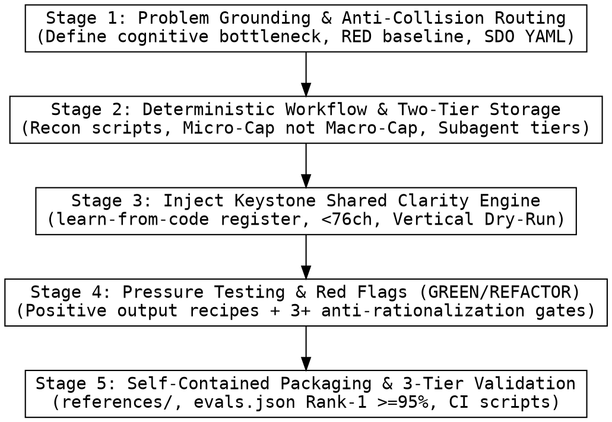

# Keystone Craft — Meta-Skill for Authoring, Refactoring & Validating Keystone Skills

Author, refactor, pressure-test, and validate skills in the **Keystone** ecosystem (*"Ship at AI speed without Comprehension Debt — The Human-in-Command Agent Skills Ecosystem"*). Writing a skill is **Test-Driven Development applied to agent behavior and human comprehension**: observe baseline agent failures (`RED`), write a deterministic skill with positive output contracts (`GREEN`), and close rationalization loopholes (`REFACTOR`).

**REQUIRED BACKGROUND:** You MUST obey `keystone:using-keystone` when authoring any skill or communicating with the user.

**Announce at start:** `"Using keystone:craft to design, author, or validate [target skill name]."`

<HARD-GATE>
**Violating the letter of the rules is violating the spirit of the rules.**
NEVER write or edit a `SKILL.md` without first defining the baseline failure mode (`RED`) and checking routing boundaries against all sibling Keystone skills. NEVER impose arbitrary total line caps on `SKILL.md` or deep technical explanations (`Micro-Cap, Not Macro-Cap`: prioritize 100% completeness of rules and concrete `❌ Bad` vs. `✅ Good` examples over arbitrary total line limits). Write all `SKILL.md` and `references/*.md` files in concise, imperative English (`MUST`, `NEVER`, active verbs, zero zombie nouns), while enforcing 100% natural spoken user-language output (`learn-from-code` register) across all generated `.md` docs and chat responses. Every change MUST pass `bash tests/validate-skills.sh`, `bash tests/validate-routing.sh`, and `bash scripts/bump-version.sh --check`.
</HARD-GATE>

---

## 1. Keystone Ecosystem Routing Map (Anti-Collision Boundaries)

Before writing or editing any skill, verify its exact boundary against the 10 Keystone skills so two skills never compete for the same user prompt:

| Skill (`skills/<name>/`) | Primary Cognitive Bottleneck Solved | Triggering Scope (`When to Use`) | Explicit Hand-Off (`When NOT to Use`) |
| :--- | :--- | :--- | :--- |
| **`using-keystone`** | Session-start routing & inconsistent explanation quality across skills | Loaded automatically at session start as the bootstrap router and Shared Clarity Engine | Never invoked directly as a task workflow; delegates immediately to the matching domain skill |
| **`map`** (`keystone:map`) | Day-1 macro blindness in an unfamiliar repo or monorepo | Whole-repo onboarding, Composition Root wiring, `.keystone/map/01-coverage-ledger.md` ($100\%$ module audit), `docs/keystone/map/` Atlas, and `./AGENTS.md` lock-in | Tracing 1 specific workflow end-to-end (`flow`), adaptive code/concept explanation in chat (`explain`), reviewing a `git diff` with a quiz (`decode`), debugging crashes (`trace`) |
| **`flow`** (`keystone:flow`) | Losing the thread across files when tracing a specific feature or pipeline | Single-pass 5-section end-to-end execution walkthrough (`docs/keystone/flows/YYYY-MM-DD-<flow>.md` or `docs/keystone/map/flows/flow-XX-<name>.md`) + `"Where to Touch"` playbook | Mapping an entire repo (`map`), adaptive structure-free explanation in chat (`explain`), or commit diff review with a 2-turn Quiz Gate (`decode`) |
| **`explain`** (`keystone:explain`) | Robotic walls of prose or rigid multi-section templates when answering focused code/technical questions in chat | Adaptive structure-free explanation of any code snippet, function, algorithm, hook, or technical concept in chat using `learn-from-code` rules (`< 76` chars, `Contrastive Why`, `Vertical Dry-Run`) | Whole-repo architecture mapping (`map`), saving 5-section multi-file flow playbooks (`flow`), or 2-turn Quiz Gate commit reviews (`decode`) |
| **`decode`** (`keystone:decode`) | Copy-pasting dense algorithms, regexes, bitwise math, or AI-generated `git diff` patches without understanding them | Explaining an isolated `< 30`-line function/snippet or reviewing a `git diff` / commit across a 2-turn Cognitive Verification Quiz Gate (`Sections 1–5` -> `Sections 6–8`) | Adaptive structure-free explanation without a quiz (`explain`), multi-file feature flows (`flow`), or whole-repo mapping (`map`) |
| **`design`** (`keystone:design`) | Vibe-coding features without evaluating architectural tradeoffs or legacy data compatibility | Pre-coding RFC/spec (`docs/keystone/specs/YYYY-MM-DD-<topic>-design.md`), contrasting `❌ Naive approach [Q]` vs. `✅ Proposed design [P]`, and checking `localStorage`/DB/cache compatibility | Mapping existing repos (`map`) or implementing already-approved plans (`forge`) |
| **`forge`** (`keystone:forge`) | Passive atrophy when AI writes 100% of the code | Active-learning implementation: AI scaffolds 90% of boilerplate and leaves 5–15 core decision lines marked `TODO(human)` with a 4-bullet implementation guide | Designing pre-code architecture (`design`) or explaining existing code (`decode` / `flow`) |
| **`brief`** (`keystone:brief`) | Freezing up when a Tech Lead, Manager, or PM asks tough questions about AI-assisted code | Post-implementation briefing: summarizes business rules, hidden invariants, and runs an interactive Tech Lead / PM edge-case Q&A drill before meetings | Code-level line-by-line review (`decode`) or automated PR static auditing (`audit`) |
| **`audit`** (`keystone:audit`) | Reviewer fatigue on large Pull Requests (`500+` LOC) where subtle bugs hide inside boilerplate churn | Risk-tiered PR auditing: filters 80% noise and catches concurrency bugs (`race condition`, `deadlock`), swallowed errors, `O(N^2)` loops, and cross-file contract breaks | Explaining a small learning diff (`decode`) or debugging a live crash stacktrace (`trace`) |
| **`trace`** (`keystone:trace`) | Blind AI "guess-and-patch" loops when a runtime crash, panic, or test failure occurs | Root-cause debugging (`Defect -> Infected State -> Failure`): halts blind patching and pinpoints exact debugger `breakpoint` coordinates (`filename:line`) + live state invariant checks | General code explanation without a bug/crash (`decode` / `flow`) |
| **`shield`** (`keystone:shield`) | Breaking hidden callers or forgetting coupled files when shipping a change | Blast-radius scan, boundary `unit test` locking, and exporting Co-Change rules into `./AGENTS.md` and path-scoped `.cursor/rules/<domain>.mdc` files | Initial Day-1 repo onboarding (`map`) |
| **`craft`** (`keystone:craft`) | Inconsistent, vague, or untested `SKILL.md` instructions that cause AI drift or Comprehension Debt | Creating, editing, standardizing, pressure-testing, or authoring `evals.json` routing benchmarks for any Keystone skill | Executing product engineering tasks directly (use `map`, `flow`, `decode`, `design`, `forge`, `brief`, `audit`, `trace`, or `shield`) |

---

## 2. The 5-Stage Skill Crafting Pipeline



### Stage 1: Problem Grounding, TDD Baseline (`RED`) & Anti-Collision Routing
1. **Observe the `RED` Baseline Failure First:**
   - Before drafting or editing `skills/<name>/SKILL.md`, run a realistic user prompt in a subagent *without* the target skill (or inspect a failing transcript).
   - Record verbatim how the agent fails: Does it trust stale `README.md` claims? Over-translate developer terms (`wheel`, `shell`, `agent`, `dict`) into stiff textbook nouns? Dump a 100-line duplicate wall of text in chat after already saving a `.md` file? Skip `Contrastive Why` or cram code traces into a jagged 4-column table?
2. **Verify Zero Scope Collision:**
   - Cross-check the new skill against the Section 1 Routing Map. Every skill MUST include a `## When to Use` section with both positive triggers (`Use keystone:<name> when...`) and explicit negative hand-offs (`Do NOT use keystone:<name> when... — **REQUIRED SUB-SKILL:** Use keystone:<other>`).
3. **Skill Discovery Optimization (SDO) Frontmatter Rules:**
   - `name`: Lowercase kebab-case (`[a-z0-9-]+`, matching the directory `skills/<name>/`).
   - `description`: Single-line string (`< 1024` characters) starting with **`Use when ...`** in third person.
   - **Triggering Conditions Only — Zero Workflow Spoilers & Zero Negative Keyword Pollution in YAML:** Describe *when* to activate (user symptoms, task scale, artifacts) in the YAML `description`, and place negative hand-offs (`Do NOT use when...`) inside `## When to Use` in the markdown body so TF-IDF / semantic routers never match sibling keywords in frontmatter. NEVER summarize the internal step-by-step workflow in `description` (agents that read a workflow summary in `description` take shortcuts and skip reading the `SKILL.md` body).

### Stage 2: Deterministic Workflow, Two-Tier Storage & Subagent Economics
1. **Deterministic Recon Before Reasoning:**
   - Convert vague advice (*"explore the codebase"*) into deterministic phases backed by shell commands, `Grep`, `Glob`, AST/Git scripts (e.g., `bash skills/map/scripts/recon-graphs.sh`), and targeted `read_file` slices. Always invoke bundled scripts through their interpreter (`bash ...`, `python3 ...`), never by bare path.
2. **Prioritize Completeness Over Arbitrary Total Line Caps (`Micro-Cap, Not Macro-Cap` + `Proportion`):**
   - **Zero Arbitrary Total Line Caps on `SKILL.md` or Deep Technical Reports:** Never impose an arbitrary macro line cap (such as `< 450` or `< 500` lines) on `SKILL.md`, `flows/flow-XX-<name>.md`, `components/comp-<domain>.md`, or `architecture/*.md`. Arbitrary line caps force authors and agents to delete concrete `❌ Bad` vs. `✅ Good` examples, skip `Contrastive Why`, hide core logic behind `...`, or compress explanations into robotic telegraphic prose.
   - **Enforce `Micro-Cap` Per Building Block:** Keep every individual bullet bite-sized (`1 idea = 1–2 short spoken sentences`), keep every line inside code blocks, `//` comments, and ASCII diagrams `< 76` characters, assign **1 cohesive end-to-end workflow per `flows/flow-XX-<name>.md` file**, and scale the number of generated files proportionally to the repo's real complexity (`Proportion`).
   - **Cap Only Always-On Routing Index & Agent Config Files (Group 1):** Keep `docs/keystone/map/00-INDEX.md <= 150` lines, the `<!-- keystone-map:start -->` pointer block in `./AGENTS.md <= 15` lines (total `./AGENTS.md < 100–300` lines), and `.cursor/rules/<domain>.mdc < 200` words (`alwaysApply: true`) or `200–500` words (`alwaysApply: false`).
3. **Two-Tier File Storage (`docs/keystone/` vs. `.keystone/`) & Crisp Chat Handoff:**
   - **Tier 1 — Human & Agent Persistent Docs (`docs/keystone/<category>/`):** Save architecture atlases to `docs/keystone/map/`, standalone flow dissections to `docs/keystone/flows/YYYY-MM-DD-<flow-slug>.md`, design specs to `docs/keystone/specs/YYYY-MM-DD-<topic>-design.md`, and implementation plans to `docs/keystone/plans/YYYY-MM-DD-<feature-name>.md` *(user preferences for location always override defaults)*. Open every saved entry `.md` file with the standardized routing header:
     ```markdown
     # [Title]

     > **For agentic workers:** REQUIRED SUB-SKILL: Use `keystone:<sub-skill>` to [next action].

     **Goal:** [1 sentence in the user's language]
     **Architecture / Entry Point:** [1-2 sentences or `path/to/file:line`]
     **Tech Stack:** [Core tools/languages]
     ```
   - **Tier 2 — Machine Audit & Ephemeral State (`.keystone/` with self-ignoring `.gitignore`):** Store machine audit ledgers (`.keystone/map/01-coverage-ledger.md`), tag caches (`.keystone/cache/`), and temporary recon JSON (`.keystone/tmp/`) inside `.keystone/` with `.keystone/.gitignore` containing `*` so machine tokens (`CORE_WIRED`, `C_wiring: 100%`, 12-char Git hashes) never clutter `docs/` or `git status`.
   - **Crisp Chat Handoff (`<= 15–20` Lines — Zero File-to-Chat Duplication):** Whenever a skill writes `.md` documentation files to `docs/keystone/...`, **NEVER copy-paste or repeat the saved `.md` file contents or redraw the ASCII diagram in the chat response!** Present a concise `<= 15–20`-line Chat Handoff containing: (a) clickable links to the saved `.md` entry file and `AGENTS.md` + a 1–2 sentence overview, (b) a 4–6 bullet **"What to Read & Why"** guide linking both `.md` guides and `filename:line` source files, (c) any `⚠️` hidden bugs discovered, and (d) a 1-sentence next-step question.
4. **Subagent Economics & File-Based Handoffs:**
   - When a skill dispatches parallel subagents (e.g., `map` or `audit`), require **Model Tier Pinning** (`haiku` / `flash` for bounded file-slice scouts; `sonnet` / `pro` for read-only verification and synthesis), pass exact `file:line_start-line_end` AST slices rather than whole `> 500`-line files, and pass `USER_LANGUAGE` explicitly so subagents write output files directly in the user's language.

### Stage 3: Mandatory 3-Layer Injection of the "Keystone Shared Clarity Engine" (`learn-from-code` Register)
Every Keystone skill that explains code, architecture, bugs, or designs MUST enforce `keystone:using-keystone` through **3 redundant layers** inside its `SKILL.md` (so standalone invocations and subagents never miss the register):
- **Layer 1 (Phase 0 Explicit Load Step):** Include an explicit step 1 in `Phase 0` / `Step 1` instructing the agent: *"If `skills/using-keystone/SKILL.md` is not already loaded in your current context (e.g., in a standalone or subagent run), call `read_file` on `skills/using-keystone/SKILL.md` before drafting any output."*
- **Layer 2 (Inline Language, Syntax & Visual Clarity Rules):** Embed the 3 discipline groups below (`3.1`, `3.2`, `3.3`) directly inside the target `SKILL.md` so the rules are present even if a subagent only reads that single file.
- **Layer 3 (Pre-Output Clarity & Register Verification Gate):** Place an explicit 6-point verification checklist right before saving `.md` files or sending the chat response.

#### Group 3.1 — Language & Everyday Spoken Developer Register Discipline
1. **Match the User's Language Automatically Across Chat AND 100% of Generated `.md` Files:**
   - Localize all section headers, bullet labels, walkthrough labels, and inline `//` code comments into the exact language the user used in their prompt. Never write chat in Vietnamese while leaving generated `.md` files in English.
2. **Zero Dual-Language Header Clutter & Zero Academic Jargon in Output:**
   - Use natural monolingual labels in the active language. NEVER pair two languages side-by-side (`<Local Label> (<English Label>):`), and NEVER print internal/academic framework labels (`RAD-AI E1`, `C4-E1`, `QOC/ATAM`, `Zeller's Infected State`, `Author Fractal Value F`) in user-facing headers, diagrams, or prose.
3. **Natural Developer Code-Switching (Never Over-Translate Core Developer Terms):**
   - Preserve universal technical terms that native developers say every day in English (`git diff`, `commit`, `repo`, `monorepo`, `package`, `target`, `pipeline`, `CI/CD`, `script`, `shell`, `CLI`, `terminal`, `dict`, `list`, `array`, `object`, `struct`, `class`, `function`, `module`, `plugin`, `agent`, `wheel`, `binary`, `build`, `test`, `unit test`, `query`, `flag`, `config`, `race condition`, `deadlock`, `in-place`, `offset`, `stream`, `buffer`, `fallback`, `edge case`, `breakpoint`, `mock`, `payload`, `thread`, `async/await`, `callback`, `hook`, `state`, `migration`, `backfill`, `schema`, `atomic`, `middleware`, `dependency injection`, `router`, `idempotency`, `rdeps`).
   - NEVER translate `wheel` into vehicle wheels (*"bánh xe phân phối"*), `shell` into outer shells (*"trình vỏ"*), `agent` into textbook AI nouns (*"tác tử"*), `dict` into language dictionaries (*"từ điển"*), `migration` into bird migration, or `atomic` into nuclear physics.
   - Keep unfamiliar domain-specific identifiers, framework APIs, or callbacks in backticks and attach a plain-language explanation of their role on first mention.
4. **Mechanical Plain-Language Syntax (`Concrete Actor + Strong Action Verb`, `One Word = One Meaning`, `Zero Translationese`):**
   - **Concrete Actor + Strong Action Verb (`Zero Zombie Nouns`):** Make every sentence subject a concrete actor (`User`, `Checkout screen`, `Router`, `CI script`, `Function X`) paired directly with a strong action verb (`overwrites`, `skips`, `blocks`, `prefixes`, `injects`, `validates`). Never turn verbs into abstract nominalizations ("zombie nouns") or open sentences with wrapper phrases (*"The implementation of..."*, *"The execution of..."*):
     - ❌ *Bad (Zombie Nouns):* `"The implementation of prefixing performs the isolation of identifiers to prevent the occurrence of data collision."`
     - ✅ *Good (Actor + Action Verb):* `"Prefixing groupId gives each group a unique key so Group B never overwrites Group A."`
   - **Ban "Translationese", Literal Metaphor Calques & Bureaucratic File Titles:** Write every section as a friendly senior developer speaks aloud to a coworker at their desk. Never translate English metaphors (`drop`, `isolate`, `deduplicate`, `preserve`, `hydrate`, `swallow`, `plumbing`) or internal document roles (*"coverage ledger"*, *"agent contract"*, *"data dictionary"*, *"control plane"*, *"execution spine"*, *"composition root"*) word-by-word into stiff legal/accounting/academic phrases in non-English output; express them naturally (*"bảng rà soát thư mục & lỗi tiềm ẩn"*, *"quy tắc lệnh chạy cho AI (`AGENTS.md`)"*, *"cấu trúc dữ liệu & cấu hình dùng chung"*, *"nhóm script điều phối CI"*, *"luồng chạy chính"*, *"điểm khởi chạy chính"*). Never narrate syntax operators pedantically (*"the ternary operator returns..."*).
   - **One Word, One Meaning (`Zero Synonym Rotation`):** Once you name a domain entity or concept in the first sentence, use that exact term throughout the entire response.
   - **One Clear Idea Per Sentence, `Old-Before-New` Chaining & Zero `->` Prose Chains:** Write separate, complete spoken sentences ending with a period (`.`) linked by `Old-Before-New` transitions (open sentence 2 with the concept or result produced at the end of sentence 1). NEVER chain prose clauses with `->` arrows and NEVER write choppy telegraphic "half-prose, half-code" fragments (`"✅ Branch 2a matches k === ..."`).

#### Group 3.2 — Cognitive Load & Visual Signaling Rules (`learn-from-code` Core)
1. **Start With 100% Plain-Language Concepts in Section 1 (`Big Picture`):**
   - Open Section 1 directly with 4 crisp bullets (`Symptom`, `Root cause`, `Fix`, `Concrete example` for bug fixes, OR `Goal`, `Key design challenge` with a brief everyday analogy + bite-sized `*italic:*` sub-bullets, `Core approach`, `Concrete example` for features/flows/maps).
   - **Zero File Paths, Function Names, or Local Variable Names in Section 1 Prose — But ALWAYS Name Real Tools & Platforms Directly:** Never mention file paths (`pipeline.py:19`), function names (`get_package_step`), or local variable names (`reverse_deps_to_build`) in the 3 opening prose bullets; save those code symbols for Sections 2 and 3. However, ALWAYS name real tools, platforms, and developer concepts (`Bazel`, `Buildkite`, `Git`, `Python`, `CI pipeline`, `monorepo`, `package`, `wheel`, `commit`, `unit test`) directly—never hide tool names behind riddle-like circumlocutions (*"a specialized compilation utility"*, *"a cloud orchestration platform"*).
   - Place `⚠️ Defect Alert` blocks at the top of `Verification & Hidden Risks` after the code walkthrough, never at the top of Section 1.
2. **Semantic Traffic-Light Icons Only (`✅`, `❌`, `⚠️`):**
   - Use ONLY three functional status icons across all prose and `.md` files: `✅` (valid state, passed check, working fix), `❌` (broken state, rejected check, naive approach that fails, dead code), and `⚠️` (exclusively for `Defect / Sensitivity Alert` blocks or runtime reflection seams). Ban decorative emojis (`🚀`, `💡`, `✨`, `📌`, `🔥`, `🔌`).
3. **Crisp Execution Spine (`3–6` Steps) & No Fabricated "State Lifecycles" for Stateless Code:**
   - In Section 2 (`Main Execution Flow`), trace the end-to-end spine in **3–6 short, 1-sentence numbered steps**, naming **at most 1 primary function, script, or hook per step** (`[`filename:line`](path#Lline)`). Never write a 10-step wall of text narrating every tiny helper, and never fabricate an artificial "State Lifecycle" section for stateless scripts.
4. **Pre-Decode Unfamiliar APIs/Hooks & Syntax Anatomy Legend:**
   - Immediately before any code block that uses an unfamiliar library API, CLI query (`bazel query`), framework hook, middleware, or callback, list a bite-sized bullet stating: **(a) what it controls**, **(b) the exact moment it runs**, **(c) what its incoming parameters hold**, and **(d) what its return value causes**.
   - When a snippet contains dense regexes, bitwise masks, format specifiers, or protocol tokens, place a `< 76`-char `// Anatomy: ...` comment on the first line inside the code block.
5. **Complete Enclosing Signatures, Subgoal Comments (`// 1.`, `// 2a.`), ASCII Rulers & Two-Part Code Follow-Up:**
   - Quote complete logical steps keeping the **enclosing function/method/class/struct signature** (eliding only repetitive boilerplate with `...`).
   - Put variable, magic-number, and fallback explanations directly inside `< 76`-char numbered **Subgoal Comments** (`// 1.`, `// 2a.`) in the user's language, add concrete evaluated sample values above branch/interpolation expressions, and include a `< 76`-char **ASCII Ruler Diagram** whenever non-trivial spatial/slice/offset math (`Index + Length`, `Substring`, `slice`, byte offsets, `X, Y` coordinates) occurs.
   - Immediately below each code snippet, include **only 2 top-level items** (localized naturally without parenthetical English labels):
     1. **Why the code is written this way** (*Contrastive Why*): Bite-sized indented sub-bullets starting with `*italic (Step // 1. / Branch // 2a.):*` explaining in 1–2 short spoken sentences why each guard is needed and what concrete bug happens if omitted.
     2. **Step-by-step case walkthrough** (*Visual Dry-Run — Conversational Vertical Cards, Never Multi-Column Tables*): State shared initial context upfront, then format each case as `- **Case 1 — <Plain-language scenario title>:**` with 3 child sub-bullets (`*Input:*`, `*How the code checks it:*`, `*Result:*` localized into the user's language) written in smooth, complete spoken sentences with `✅` and `❌` (or a `Vertical Interleaved Timeline t1..t4` for concurrency/async flows).

#### Group 3.3 — Cross-Surface CLI & GUI Rendering Discipline
1. **76-Character Width Cap:** Keep every line inside ASCII diagrams, ASCII rulers, inline `//` comments, and multi-condition code expressions **strictly under 76 characters** (wrap long comments across consecutive `//` lines).
2. **Zero Multi-Column Trace Tables & Safe Backtick Escaping:** Never cram code walkthroughs into 4-column Markdown tables. Never wrap an expression that already contains backticks (such as `` `${a}_${b}` ``) inside single outer backticks `` `...` ``.
3. **Clickable Visible `filename:line` Links:** Place `filename:line` inside the visible brackets with backticks **inside** the brackets (`` [`OrderService.ts:142`](src/services/OrderService.ts#L142) `` — never wrap the entire `[label](url)` link in outer backticks, and never abbreviate to a bare basename inside `docs/keystone/` files). Link only on the first mention within each section.
4. **Pure Portable Markdown Only:** Ban raw HTML tags (`<br>`, `<details>`, `<summary>`, `<sub>`) and `mermaid` fenced blocks across all outputs and `.md` files.

### Stage 4: Pressure Testing (`GREEN -> REFACTOR`), Positive Output Recipes & Anti-Rationalization Red Flags
1. **Match the Form to the Failure (Before Writing Guidance, Classify the Baseline Failure):**
   The form that bulletproofs one failure type measurably backfires on another:

   | Baseline Failure Observed in `RED` | Right Form (`✅`) | Wrong Form (`❌`) |
   | :--- | :--- | :--- |
   | **Skips/violates a rule under pressure** (knows better, does it anyway) | `<HARD-GATE>` prohibition + Rationalization Counter-Table + `Red Flags` list | Soft guidance (*"prefer..."*, *"consider..."*) |
   | **Complies, but output has the wrong shape** (bloated chat handoff, missing `Contrastive Why`, robotic headers) | **Positive recipe or contract:** state what the output IS—its sections and sub-bullets in exact order | Prohibition list (*"don't restate"*, *"never narrate"*) |
   | **Omits a required element** from something already produced | **Structural:** `REQUIRED` slot or field directly inside the template they fill in | Prose reminders near the template |
   | **Behavior depends on a condition** | **Conditional keyed to an observable predicate** (*"when saving `.md` files to disk, output a `<= 15–20`-line Chat Handoff"*) | Unconditional rule + exemption clauses |

   - **Why prohibitions backfire on shaping problems:** Under a competing incentive (*"be thorough"*), agents negotiate with *"don't X"*. A positive recipe leaves nothing to negotiate: the output matches the stated shape or it doesn't.
   - **No nuance or exemption clauses:** Appending *"unless needed"* or *"this limit doesn't apply to X"* reopens negotiation and degrades compliance. Express real exceptions as separate conditionals on observable predicates.
2. **Simulate 3+ Adversarial Pressure Scenarios & Counter Every Excuse:**
   - Test the drafted skill in a fresh subagent against time pressure, sunk-cost pressure, and messy real-world repos (`bazel-monorepo-example`, 20k-LOC services).
   - Never skip testing:

   | Excuse for Skipping Skill Testing | Reality |
   | :--- | :--- |
   | *"The skill instructions are obviously clear."* | Clear to the author $\neq$ clear to a fresh subagent under context load. Test it. |
   | *"It's just a formatting or reference update."* | References and templates have schema gaps (e.g., wrong JSON keys or broken relative paths). Test retrieval and execution. |
   | *"Testing with a subagent takes too long."* | 5 minutes of subagent testing saves hours of debugging drifted outputs across user sessions. |

### Stage 5: Self-Contained Packaging & 3-Tier Evaluation
1. **Self-Contained Directory Layout:**
   ```text
   skills/<name>/
   ├── SKILL.md              # Main skill instructions (imperative English)
   ├── evals.json            # Positive + pairwise negative routing cases
   ├── references/           # Heavy templates & domain guides (optional)
   └── scripts/              # Deterministic recon/validation scripts (optional)
   ```
   - Every path matching `skills/<name>/(scripts|references)/...` mentioned in `SKILL.md` MUST exist on disk (verified by `bash tests/validate-skills.sh`).
2. **Author Project-Agnostic `skills/<name>/evals.json` Using the Exact Schema & Register in `.version-bump.json`:**
   - **Zero Project-Specific Filenames in `SKILL.md` or `evals.json`:** A Keystone skill is a reusable cross-project tool, NEVER a narrative about one specific benchmark repo. Never hardcode benchmark-specific file paths or function names (such as `.buildkite/utils.py`, `get_package_step`, `get_paths`, `test_main.py`) inside `SKILL.md` rules or `evals.json` prompts (doing so pollutes TF-IDF vectors and causes pairwise negative collisions in `validate-routing.sh`).
   - Write `skills/<name>/evals.json` using singular `"positive"` and `"negative"` array keys (`6+` positive prompts with `"top_k": 1`, `8+` pairwise negative prompts with `"owner"` naming the exact sibling skill from `map`, `flow`, `decode`, `design`, `forge`, `brief`, `audit`, `trace`, `shield`, `craft`):
     ```json
     {
       "skill": "<name>",
       "version": "0.1.0",
       "positive": [
         { "prompt": "<realistic trigger prompt 1>", "top_k": 1 }
       ],
       "negative": [
         { "prompt": "<sibling trigger prompt>", "owner": "<sibling-skill>" }
       ],
       "expectations": [
         "<verifiable behavioral expectation 1>"
       ]
     }
     ```
   - Register `skills/<name>/SKILL.md` and `skills/<name>/evals.json` in `.version-bump.json`.
   - Run all verification suites:
     - `bash tests/validate-skills.sh`
     - `bash tests/validate-routing.sh` (requires `Rank-1 = 100.0%` across all positive and pairwise negative cases)
     - `bash tests/hooks/test-session-start.sh`
     - `bash scripts/bump-version.sh --check`

---

## 3. Canonical Blueprint Template for Any Keystone `SKILL.md`

Use this exact structural skeleton when creating or refactoring `skills/<name>/SKILL.md`:

```markdown
---
name: <name>
description: Use when [concrete triggering conditions, symptoms, and artifacts — zero workflow spoilers and zero sibling negative keywords in YAML].
license: MIT
metadata:
  author: keystone-ecosystem
  version: "0.1.0"
  opencode/slash: "true"
  opencode/autoinvoke: "true"
---

# Keystone <Title> — <1-Line Core Value Proposition>

<1-paragraph overview stating how this skill eliminates Comprehension Debt,
prioritizes completeness of core mechanics over arbitrary length caps
(Micro-Cap, Not Macro-Cap), and enforces 3-second visual comprehension.>

**Save persistent docs to:** `docs/keystone/<category>/...` *(If applicable)*
**REQUIRED BACKGROUND:** You MUST obey the Shared Language, Plain-Language Syntax, Code-Explanation, and Visual Comprehension Core in `keystone:using-keystone`.

**Announce at start:** `"Using keystone:<name> to [specific action]."`

<HARD-GATE>
**Violating the letter of the rules is violating the spirit of the rules.**
<Imperative non-negotiable constraints: deterministic recon first, 100% natural
user-language output, zero over-translation of developer terms, and required
validation script or cognitive verification gate.>
</HARD-GATE>

## When to Use (Scale-Based Routing)

- **Use `keystone:<name>` when:**
  - <Concrete trigger 1>
  - <Concrete trigger 2>
- **Do NOT use `keystone:<name>` when:**
  - <Sibling boundary 1> (**REQUIRED SUB-SKILL:** Use `keystone:<sibling-1>`).
  - <Sibling boundary 2> (**REQUIRED SUB-SKILL:** Use `keystone:<sibling-2>`).

## Deterministic Execution Pipeline

```text
+========================================================================+
|        KEYSTONE:<NAME> EXECUTION PIPELINE (< 76 CHARS WIDE)            |
+========================================================================+
|  [Phase 1: Load using-keystone + Deterministic Recon / Grounding]      |
|                                  |                                     |
|                                  v                                     |
|  [Phase 2: Core Analysis / Artifact Generation (learn-from-code style)]|
|                                  |                                     |
|                                  v                                     |
|  [Phase 3: Pre-Output Clarity Verification Gate & Crisp Chat Handoff]  |
+========================================================================+
```

### Phase 1: Load Clarity Engine & Deterministic Recon
1. **Load `using-keystone` First:** If `skills/using-keystone/SKILL.md` is not already loaded in your current context (e.g., standalone or subagent run), call `read_file` on `skills/using-keystone/SKILL.md` before drafting any text.
2. **Deterministic Recon:** <Grep / Glob / AST / Git commands and targeted source reads.>

## Inline `using-keystone` / `learn-from-code` Language, Syntax & Visual Clarity Rules

<Embed Group 3.1 (Language & Natural Code-Switching), Group 3.2 (Section 1
Plain-Language, Pre-Decoding, Subgoal Comments, Contrastive Why + Vertical
Case Walkthroughs), and Group 3.3 (< 76-char width cap, clickable
filename:line links, zero HTML/Mermaid) directly inside SKILL.md.>

## Output Contract (`learn-from-code` Clarity Engine)

<Positive recipe specifying the exact sections, 4-bullet Section 1 Big Picture
naming real tools directly, < 76-char subgoal-commented code blocks (// 1.),
Why the code is written this way, Step-by-step Vertical Case Walkthroughs
(✅/⚠️/❌), and Crisp Chat Handoff if files are saved to disk.>

## Pre-Output Clarity & Register Verification Gate (Run Before Saving or Sending)

- [ ] **Check 1 (Matched Language & Zero Jargon):** 100% of headers, prose, and `//` comments match the user's language with zero `<Local> (<English>):` headers and zero academic jargon (`RAD-AI E1`, `QOC/ATAM`, `Zeller`).
- [ ] **Check 2 (Everyday Developer Terms Preserved):** Universal terms (`CI`, `pipeline`, `monorepo`, `package`, `target`, `wheel`, `script`, `dict`, `shell`, `CLI`, `terminal`, `agent`, `build`, `test`, `unit test`, `commit`) are preserved in English.
- [ ] **Check 3 (Section 1 Hygiene):** Section 1 prose has zero file paths, function names, or local variable names, and names real tools (`Bazel`, `Buildkite`, `Git`) directly without riddles.
- [ ] **Check 4 (Sentence Mechanics):** Every sentence uses `Concrete Actor + Strong Action Verb` and `Old-Before-New` chaining (zero `->` prose chains, zero zombie nouns).
- [ ] **Check 5 (Code & Visual Width `< 76` Chars):** Every line inside code blocks, `//` comments, and ASCII diagrams is `< 76` characters, keeps enclosing signatures, and is followed by `Why the code is written this way` + `Vertical Case Walkthrough` cards (`✅`/`❌`).

## Red Flags — STOP and Fix Before Sending

- **<Failure Mode 1>:** <Direct correction>
- **<Failure Mode 2>:** <Direct correction>
- **<Failure Mode 3>:** <Direct correction>
```

---

## 4. Verification & Exit Criteria Checklist

Before claiming any skill creation or update is complete, run and verify:

- [ ] **Frontmatter & SDO:** `name` matches `skills/<name>/`, `description` starts with `Use when `, includes negative routing boundaries, and contains zero workflow spoilers.
- [ ] **Zero Arbitrary Macro Line Caps on Explanations:** Enforces `Micro-Cap, Not Macro-Cap` (`1 idea = 1–2 short spoken sentences per bullet`, `< 76`-char lines inside code/comments/ASCII diagrams, zero artificial total line limit on `SKILL.md` or deep flow/component reports).
- [ ] **`learn-from-code` Clarity Engine Embedded:** Enforces 100% natural spoken user language across chat and generated `.md` files, preserves everyday English developer terms (`CI`, `pipeline`, `monorepo`, `package`, `target`, `wheel`, `script`, `dict`, `shell`, `CLI`, `terminal`, `agent`, `build`, `test`, `unit test`, `commit`), bans academic jargon (`RAD-AI E1`, `QOC/ATAM`, `Zeller`) from headers/prose, and uses Vertical Case Walkthrough cards (`*Input:*`, `*How the code checks it:*`, `*Result:*`).
- [ ] **Two-Tier Storage & Crisp Chat Handoff (for file-generating skills):** Human docs saved under `docs/keystone/...` with standardized routing headers; machine ledgers/caches auto-ignored under `.keystone/...`; chat handoff `<= 15–20` lines with zero copy-paste duplication of saved `.md` files.
- [ ] **Automated CI Suite Passes (`exit code 0`):**
  - `bash tests/validate-skills.sh`
  - `bash tests/validate-routing.sh`
  - `bash tests/hooks/test-session-start.sh`
  - `bash scripts/bump-version.sh --check`

---

## Red Flags — STOP and Fix Before Sending

- **Imposing arbitrary total line caps (`< 450` or `< 500` lines) on `SKILL.md` or deep flow/component explanations:** Never truncate rules, concrete `❌ Bad` vs. `✅ Good` examples, or code steps to hit an arbitrary total line count; enforce `Micro-Cap, Not Macro-Cap` (`< 76`-char lines in code/diagrams and bite-sized `1–2` sentence bullets).
- **Allowing over-translation, riddle circumlocutions in Section 1, or academic buzzwords in user-facing output:** Never allow a skill to translate `wheel`, `shell`, `agent`, `dict`, `pipeline`, or `package` into stiff textbook nouns, hide real tool names (`Bazel`, `Buildkite`, `Git`) behind riddles in Section 1, or print `RAD-AI E1` / `QOC/ATAM` / `Zeller` in user-facing headers.
- **Dumping duplicate `.md` file contents into Chat:** Whenever a skill saves `.md` files to `docs/keystone/...`, forbid repeating the full file or ASCII diagram in chat; require a `<= 15–20`-line Crisp Chat Handoff with clickable `"What to Read & Why"` links.
- **Permitting 4-column Markdown trace tables, raw HTML tags (`<br>`, `<details>`), or `mermaid` blocks:** Always enforce Conversational Vertical Case Walkthrough cards (`✅`/`⚠️`/`❌`) and `< 76`-char pure-text ASCII diagrams.
- **Hardcoding project-specific benchmark filenames in `SKILL.md` or `evals.json`, or using wrong JSON keys (`positives`/`negatives`):** Keep `SKILL.md` and `evals.json` 100% project-agnostic, use singular `"positive"` and `"negative"` keys in `evals.json`, and never finish without running `bash tests/validate-skills.sh`, `bash tests/validate-routing.sh`, and `bash scripts/bump-version.sh --check`.
